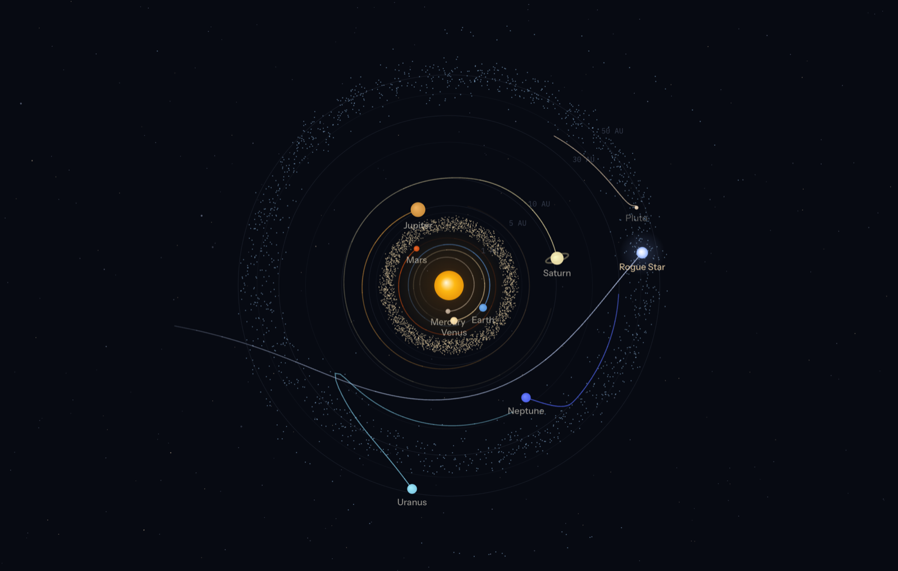

# Solar System Explorer

**An interactive gravity simulator for the solar system, built to help kids (and curious adults) see how gravity actually shapes it.**

Every planet starts where it really is today, and the simulation pulls them all on each other from there. Then you get to break things: give Jupiter 1,000 times its mass, throw a passing star through the outer planets, or delete the Sun and watch everything fly away. Then rewind and watch it un-happen.

**▶ Try it: [solar-system-gravity-simulator.vercel.app](https://solar-system-gravity-simulator.vercel.app/)**

[](https://solar-system-gravity-simulator.vercel.app/?s=flyby&d=2026-11-21&seed=42&speed=2&belts=ak)

<sub>The "Rogue star flyby" scenario about 29 years in. The star (right) has swept past Neptune, and the sharp kink in Uranus's trail is the moment it got kicked out of its orbit. Click the image to watch this exact run.</sub>

---

## What you can do

- **See today's sky.** Planets start at their real positions for today's date, on their real elliptical orbits, and the clock shows the actual calendar date as time runs.
- **Play with gravity.** The *Chaos lab* sliders change the Sun's and Jupiter's mass while everything is moving. Push Jupiter past about 80× and it ignites into a star.
- **Watch the belts.** 2,500 asteroids and 1,500 Kuiper belt objects respond to the planets' gravity. The panel counts how many get flung out or fall into the Sun.
- **Run a scenario.** Six one-click setups, described below.
- **Rewind time.** The physics runs backwards exactly, so you can replay any disaster in reverse. Scenario events undo themselves too.
- **Follow a planet.** The camera rides along with any body. Following Jupiter as the asteroid belt streams past is a good one.
- **Learn about each world.** Click any planet for its "field guide": live distance and speed, temperature, day and year length, moons, whether you could stand on it, and what you'd weigh there.
- **Share a link.** The address bar always holds the exact setup, including the same random asteroid belt, so a link reproduces what you saw.
- **Use it on a phone.** Drag to pan and pinch to zoom.

## Scenarios

| # | Scenario | What happens |
|---|---|---|
| 1 | **Today's sky** | The real solar system, as it is right now. |
| 2 | **Rogue star flyby** | A star 80% as massive as the Sun plunges through the outer solar system, passing inside Uranus's orbit. The ice giants and the Kuiper belt don't come out of it well. |
| 3 | **Binary star** | The Sun gets a red dwarf companion 14 AU out. The inner planets hang on; the giants get scrambled. |
| 4 | **Jupiter ignites** | Jupiter gains mass from year 1 to year 11 until it's 1,000× heavier and a star in its own right. |
| 5 | **Sun loses half its mass** | In year 1, the Sun loses half its mass. For a circular orbit that's exactly the escape threshold, so every planet ends up barely bound or drifting away. |
| 6 | **Delete the Sun** | In year 1, the Sun vanishes. Each planet flies off in a straight line at the speed it was orbiting. |

## Controls

| Action | Mouse / trackpad | Touch | Keyboard |
|---|---|---|---|
| Play / pause | ▶ in the time dock | ▶ | `Space` |
| Rewind | ◀◀ in the time dock | ◀◀ | `B` |
| Pan | drag | drag | |
| Zoom | scroll (zooms toward the cursor) | pinch | |
| Inspect a body | click it | tap it | `Esc` to close |
| Follow the selected body | "Follow" in its card | | `F` |
| Recenter the view | Controls → View → Recenter | | `C` |
| Load a scenario | Controls → Scenarios | | `1`–`6` |
| Trails · gravity map | Controls → View | | `T` · `G` |
| Asteroid · Kuiper belt | Controls → Belts | | `A` · `K` |
| Restart from today | ↺ in the time dock | ↺ | `R` |

## How the physics works

This is a real [N-body simulation](https://en.wikipedia.org/wiki/N-body_simulation), not an animation. Nothing moves on a pre-drawn track. Every frame, each body's motion comes only from the gravity of everything else.

- **Units:** astronomical units (AU), solar masses and years. In these units Newton's gravitational constant is G = 4π², and Earth's orbit comes out as 1 AU in 1 year.
- **Integrator:** [velocity Verlet](https://en.wikipedia.org/wiki/Verlet_integration#Velocity_Verlet) with a fixed step of 0.0002 years, about 1,200 steps per Mercury orbit. It's *symplectic*, so energy doesn't drift. Over 10 simulated years the total energy changes by less than one part in a million.
- **Time-reversible:** Verlet run with a negative time step retraces its path exactly, which is how rewind works. Asteroids take bigger steps than planets to save work, and those steps are split around the planet steps they span so they reverse exactly too. Running forward 2 years, flipping direction mid-step, and running back lands within about 10⁻¹² AU of the start.
- **Real starting positions:** planets are placed using [JPL's approximate Keplerian orbital elements](https://ssd.jpl.nasa.gov/planets/approx_pos.html) for the current date, then shifted so the whole system's centre of mass is at rest. That way the system doesn't drift off screen.
- **Asteroids are test particles:** they feel gravity from the Sun and planets but don't pull on anything themselves. That's a good approximation, since all the asteroids together weigh about 3% of our Moon, and it keeps thousands of them cheap to simulate.
- **Speed is honest:** the simulation advances by real elapsed time, so it runs at the same speed on any screen. If a device can't keep up, the dock says "max for this device" instead of quietly slowing down.

### What's simplified

- **It's flat (2D).** Real orbits are tilted slightly; Pluto's by 17°. The simulation flattens them into one plane.
- **No moons, comets or relativity.** Mercury's orbit really does precess a tiny bit more than Newton predicts; that's not modelled.
- **Distances are squashed by default** so the inner and outer planets fit on one screen. Drag *Distance warp* to "true scale" to see how empty space really is.
- **Planets and asteroids are drawn far bigger than they are.** At true scale they'd all be invisible. The asteroid belt looks crowded, but real neighbouring asteroids are typically about a million km apart.
- **Gravitational softening:** bodies that pass extremely close get a slightly softened pull, so a near-collision doesn't produce an infinite kick.

## Sharing links

The URL updates as you change things, so you can copy it from the address bar or use **Controls → Copy link**. The parameters are:

| Param | Meaning | Example |
|---|---|---|
| `s` | Scenario id: `today`, `flyby`, `binary`, `ignite`, `halfsun`, `nosun` | `s=flyby` |
| `d` | Start date | `d=2026-11-21` |
| `seed` | Random seed for the belts | `seed=42` |
| `speed` | Simulated years per real second | `speed=2` |
| `sun` / `jup` | Sun / Jupiter mass multiplier | `jup=80` |
| `belts` | `a` = asteroid belt, `k` = Kuiper belt | `belts=ak` |
| `warp`, `scale` | Distance warp, planet size | `warp=1` |
| `trails`, `grav` | `trails=0` hides trails, `grav=1` shows the gravity map | `grav=1` |
| `follow` | Body to follow | `follow=Jupiter` |

## Development

You'll need [Node.js](https://nodejs.org/) 20 or newer. The project uses [pnpm](https://pnpm.io/), which you can run through `npx` without installing it.

```bash
npx pnpm install
npx pnpm dev        # http://localhost:3000
npx pnpm build      # production build
```

### Project layout

```
app/
  layout.tsx              Fonts, page metadata
  page.tsx                Renders the simulator
components/solar-system/
  SolarSystem.jsx         Main component: simulation loop, input, URL sync
  ControlPanel.jsx        Right-hand panel: scenarios, chaos lab, belts, view, bodies
  TimeDock.jsx            Bottom dock: play, rewind, speed, date
  PlanetInfo.jsx          Field-guide card for the selected body
  ui.jsx                  Shared controls, icons, scenario glyphs
  styles.module.css       All UI styling ("modern orrery" theme)
lib/sim/
  physics.js              N-body integrator, belts, trails (time-reversible)
  ephemeris.js            Orbital elements → positions and velocities
  bodies.js               Sun, planets and Pluto with JPL orbital elements
  scenarios.js            Scenario definitions, timed events, mass ramps
  camera.js               World ↔ screen mapping, zoom, follow
  render.js               Canvas drawing
  planet-facts.js         Facts shown in the field guide
  constants.js, rng.js    Units, tuning, seeded random numbers
lib/url-state.js          Read/write the setup in the URL
```

The simulation code in `lib/sim/` has no React or browser dependencies apart from `render.js`, so you can run it straight from Node to test physics changes:

```js
import { createSystem, advance, addBelt } from "./lib/sim/physics.js";
const sys = createSystem(new Date(), 42);
addBelt(sys, "asteroids");
advance(sys, 5000, Infinity); // 5,000 steps = 1 simulated year
console.log(sys.bodies.map((b) => [b.name, Math.hypot(b.x, b.y).toFixed(2)]));
```

### Deploys

The site is hosted on [Vercel](https://vercel.com/), connected to this repository:

- **Pull requests** get their own preview deployment.
- **Merging to `main`** deploys to production at [solar-system-gravity-simulator.vercel.app](https://solar-system-gravity-simulator.vercel.app/).

Changes go through a pull request rather than being pushed straight to `main`.

## Credits

- Orbital elements: [NASA JPL Solar System Dynamics](https://ssd.jpl.nasa.gov/planets/approx_pos.html) (Standish, *Keplerian Elements for Approximate Positions of the Major Planets*).
- Planet facts: NASA; moon counts as of 2025.
- Originally prototyped with [v0](https://v0.app), then rebuilt.
- Type: [Fira Sans](https://fonts.google.com/specimen/Fira+Sans).

## License

[MIT](LICENSE) © 2026 Phillip Wheaton
